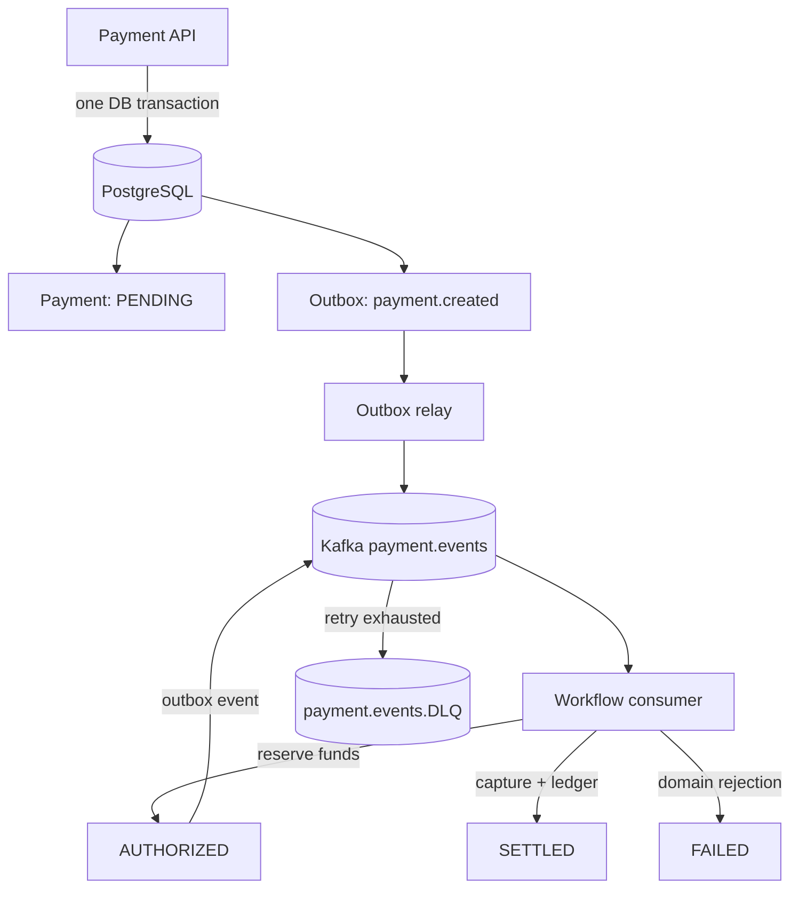

# FinFlow

FinFlow is a production-oriented financial operations platform for demonstrating backend
architecture, distributed-systems patterns, cloud infrastructure, observability, and full-stack
product engineering.

## Milestone 2: Kafka + Transactional Outbox

The payment API is now asynchronous. `POST /api/v1/payments` returns `202 Accepted` with a
`PENDING` payment. The database transaction that creates the payment also creates a
`payment.created` outbox record. A scheduled relay publishes the record to Kafka, and idempotent
consumers advance the payment state machine.



Implemented:

- Java 21 + Spring Boot
- PostgreSQL + Liquibase
- Kafka in single-node KRaft mode for local development
- `payment.created`, `payment.authorized`, `payment.failed`, and `payment.settled`
- transactional outbox with polling, `FOR UPDATE SKIP LOCKED`, and stale-claim recovery
- producer acknowledgements and Kafka idempotent producer mode
- exponential retry/backoff for outbox publication
- three consumer retries with exponential backoff, followed by `payment.events.DLQ`
- event consumers for workflow transitions, audit tracking, and DLQ monitoring
- consumer inbox/idempotency table keyed by consumer and event ID
- per-payment Kafka ordering through `paymentId` message keys
- pessimistic account locking in deterministic UUID order
- balance reservations so concurrent authorizations cannot overspend an account
- debit/credit ledger entries created only during settlement
- Micrometer counters for outbox publishing success/failure
- REST APIs, OpenAPI/Swagger, validation, error handling, and Actuator
- unit tests covering request idempotency, outbox creation, workflow transitions, and replay safety

## Delivery guarantees

The relay provides **at-least-once delivery**. A process can fail after Kafka accepts an event but
before the outbox row is marked `PUBLISHED`, so publishing the same event again is intentional.
Consumers store `(consumer_name, event_id)` in `processed_events` in the same database transaction
as their business changes. A replay therefore cannot reserve funds or write ledger entries twice.

The outbox relay retries failed sends with exponential backoff and marks an event `FAILED` after
ten attempts. Consumer failures are retried after 1, 2, and 4 seconds; an exhausted record is sent
to `payment.events.DLQ` with the original key, value, and error headers.

## Run locally

Requirements: Java 21, Maven 3.9+, and Docker with Compose.

```bash
docker compose up -d
mvn spring-boot:run
```

- Swagger: `http://localhost:8080/swagger-ui.html`
- Health: `http://localhost:8080/actuator/health`
- Metrics: `http://localhost:8080/actuator/metrics`

Run tests:

```bash
mvn test
```

## Core API

- `POST /api/v1/accounts`
- `GET /api/v1/accounts/{id}`
- `POST /api/v1/payments` with a mandatory `Idempotency-Key`
- `GET /api/v1/payments/{id}`
- `GET /api/v1/accounts/{id}/transactions`

After creating a payment, poll `GET /api/v1/payments/{id}`. A valid payment normally progresses
through `PENDING -> AUTHORIZED -> SETTLED`. Missing accounts, currency mismatch, or insufficient
available funds produce `PENDING -> FAILED`, with `failureReason` in the response.

## Important operational tables

- `outbox_events`: event payload, relay status, attempts, retry time, lock, and last error
- `processed_events`: durable consumer deduplication/inbox records
- `payments`: payment state and terminal failure reason
- `accounts`: current balance plus funds reserved by authorized payments
- `ledger_entries`: immutable debit and credit records written at settlement

For the detailed design and failure behavior, see [`docs/milestone-2.md`](docs/milestone-2.md).

## Next milestones

- Next.js + TypeScript operations dashboard
- FastAPI analytics/fraud service
- Redis caching and rate limiting
- OpenTelemetry + Prometheus + Grafana
- load testing
- GitHub Actions
- AWS ECS/RDS/S3/IAM + Terraform
- optional Kubernetes + Helm
